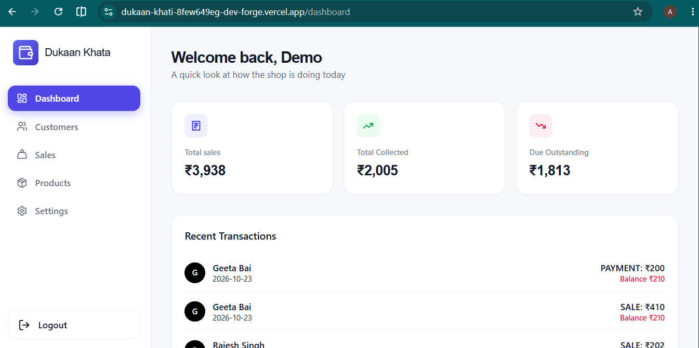
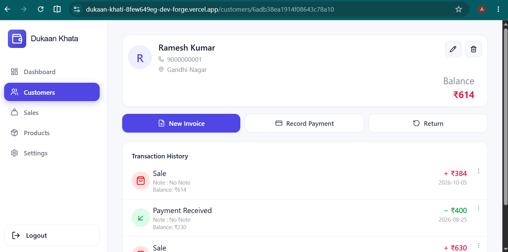
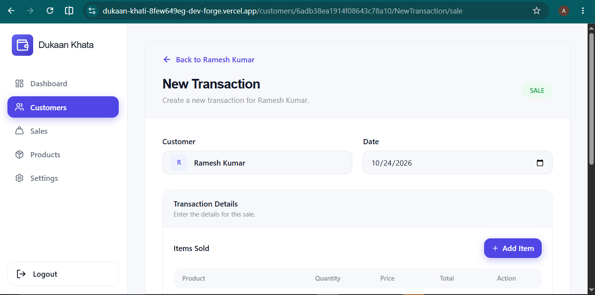
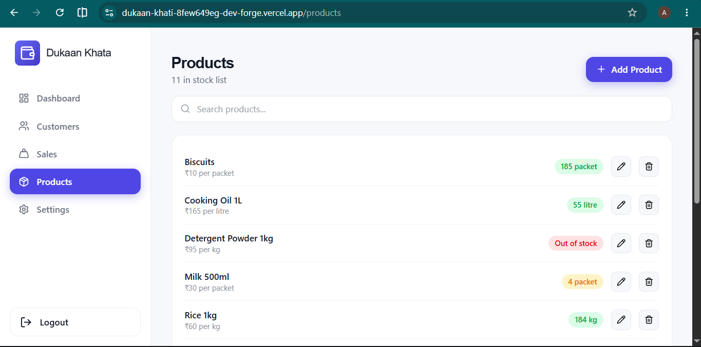

# Dukaan Khata: Frontend

Web app for **Dukaan Khata**, a digital *khata* (credit ledger) for small shops. A shopkeeper tracks customers and products, records sales, payments and returns, and always sees who owes how much and what is left in stock. It replaces the paper notebook.

- **Live demo:** `<https://dukaan-khati-8few649eg-dev-forge.vercel.app/>`
- **Backend repository (API and ledger rules):** `<https://github.com/Ashiq-Hussain-Kumar/Backend-Dukaan-Khata>`

> **Demo login:** `<demo@example.com>` / `<Demo@2026Khata>`
> The backend runs on a free plan and sleeps when idle, so the first request after a pause can take about 30 seconds. The app shows a notice while it waits.

## Screenshots

<!-- Add your screenshots to docs/screenshots and keep the file names below, or change them -->

| Dashboard | Customer ledger |
|---|---|
|  |  |

| New invoice | Products |
|---|---|
|  |  |

---

## Features

- **Dashboard:** total sales, money collected, money still due, and the latest transactions.
- **Customers:** add, search, edit and delete customers. Each customer has a ledger with a running balance after every transaction.
- **Products:** add, edit and remove products, with price, unit and stock. Colour badges show out-of-stock and low-stock items.
- **Sales, payments and returns:** pick products from your list, see the price and available stock, and the total is calculated for you. Payments record the method and who received the money. Returns record a reason.
- **Edit and delete transactions:** stock and balances are corrected automatically, including when a transaction is moved to a different customer.
- **Sales page:** every sale across all customers, with search and date filters (today, this week, this month, last month, last 3 months, this year, or a custom range).
- **Accounts:** register, log in, log out, email verification (when enabled), and resend verification link.
- **Responsive layout:** a sidebar that collapses on phones, and forms that work on small screens.
- **Clear feedback:** loading messages, a "waking up the server" notice, error banners with a Retry button, and messages for every failed action.

## Tech stack

| Area | Tools |
|---|---|
| UI | React 19, TypeScript |
| Build | Vite, React Compiler |
| Routing | React Router 7 |
| Styling | Tailwind CSS 4 |
| Icons | lucide-react |
| Linting | oxlint |

State is kept in React Context. There is no state library and no local storage. The backend is the single source of truth.

---

## How it works

### Talking to the backend

All requests go through one client, `src/utils/api.ts`:

- The base URL comes from `VITE_API_BASE_URL`.
- It sends cookies on every request (`credentials: "include"`), because the login tokens are `httpOnly` cookies that JavaScript never reads.
- It unwraps the API response and returns only the `data` part, and turns failures into errors that carry the server's own message and status.
- **Silent session refresh:** when the access token has expired, the client calls the refresh endpoint once and repeats the original request. Requests that fail at the same moment share a single refresh, because the backend rotates refresh tokens and two parallel refreshes would invalidate each other.

### Data and state

- After login, `DataContext` loads customers, products and transactions in parallel.
- After every change (create, edit or delete) the app asks the backend for fresh data instead of calculating balances itself. Balance and stock rules live in one place, the server.
- On logout, all data is cleared, so the next account never sees the previous account's data.
- `src/utils/mappers.ts` converts the API's shapes (`_id`, ISO dates, `returnInfo`) into the shapes the pages use, in one place.

### Forms

- Every submit button is disabled while its request runs, so a double click cannot create a record twice.
- The client sends only product ids and quantities. Prices and totals are calculated by the server, and the form shows them for convenience only.
- The sale form checks available stock before sending, and the server checks again.

### Routes

| Path | Page | Access |
|---|---|---|
| `/login`, `/register`, `/verify-email` | Authentication pages | logged-out users |
| `/dashboard` | Dashboard | logged-in |
| `/customers` | Customer list | logged-in |
| `/customers/:id` | Customer ledger | logged-in |
| `/customers/:id/NewTransaction/:type` | New sale, payment or return for a customer | logged-in |
| `/NewTransaction/:type` | New transaction, choosing the customer on the form | logged-in |
| `/ViewTransaction/:id` | Transaction details and delete | logged-in |
| `/EditTransaction/:transactionId` | Edit a transaction | logged-in |
| `/products` | Product list and editor | logged-in |
| `/sales` | All sales with filters | logged-in |

Logged-in routes are protected once at the layout level. A logged-in user who opens a login page is sent to the dashboard, and an unknown address redirects to the dashboard.

### Project structure

```
src/
  main.tsx            app entry
  App.tsx             routes and layout
  types.ts            shared types
  pages/              one file per screen
  components/         sidebar, stat cards, form sections, route guards, loaders
  context/            AuthContext (login state) and DataContext (app data)
  utils/              api client, mappers, currency format, running balances, validation
```

---

## Getting started

### Requirements

- Node.js 18 or newer
- The backend running locally or deployed (see the backend repository)

### Install and run

```bash
git clone <this-repo-url>
cd <repo-folder>
npm install
cp .env.example .env     # set VITE_API_BASE_URL
npm run dev
```

The app opens on `http://localhost:5173`. The backend's `CLIENT_URL` must be exactly this address for cookies and CORS to work in development.

### Environment variable

| Variable | Purpose |
|---|---|
| `VITE_API_BASE_URL` | Backend address, for example `http://localhost:5000`. No trailing slash, and without `/api/v1` |

### Scripts

| Command | Purpose |
|---|---|
| `npm run dev` | Start the development server |
| `npm run build` | Type-check and create a production build |
| `npm run preview` | Preview the production build locally |
| `npm run lint` | Run oxlint |

## Deployment notes

- Deployed as a static site (for example on Vercel). Set `VITE_API_BASE_URL` in the host's settings. Vite reads it **at build time**, so redeploy after changing it.
- Add a rewrite so reloading a deep link such as `/customers` serves the app instead of a 404. On Vercel, add `vercel.json`:

```json
{ "rewrites": [{ "source": "/(.*)", "destination": "/index.html" }] }
```

- When the frontend and backend are on different domains, the backend must run with `NODE_ENV=production` so its cookies use `sameSite: none` and `secure`.

## Testing

The app is tested manually with a written checklist covering login and session refresh, every ledger flow (sale, payment, return, edit, delete), stock and balance correctness, filters, empty, loading and error states, and data isolation between two accounts. There are no automated tests yet.

## Known limitations

- After login the app loads all customers, all products and the newest 500 transactions. Dashboard and Sales totals use the loaded transactions, which is fine for a single small shop but would need server-side pagination at scale.
- Prices in a sale come from the product and cannot be edited per sale.
- Amounts are shown in Indian rupees only.
- A sale containing a product that was removed later cannot be edited until that line is removed.
- There is no profile page or password reset yet.

## Possible improvements

- Pagination and server-side totals for large shops.
- Automated tests (component tests and end-to-end tests for the sale flow).
- Profile settings and password change.
- Per-sale negotiated prices, and printable invoices.

## Author

`<Ashiq-Hussain-Kumar>` · `<https://github.com/Ashiq-Hussain-Kumar>` · 